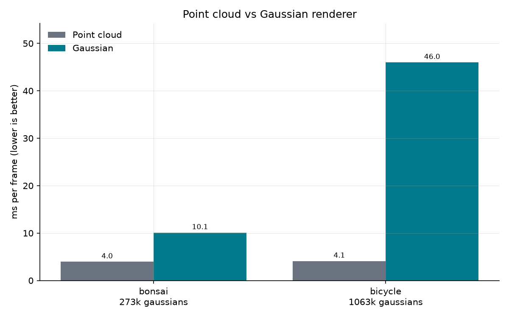
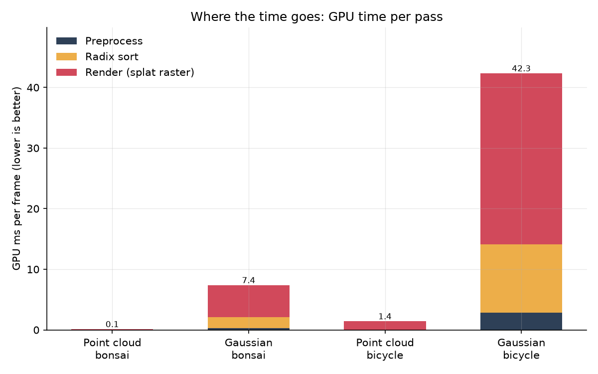
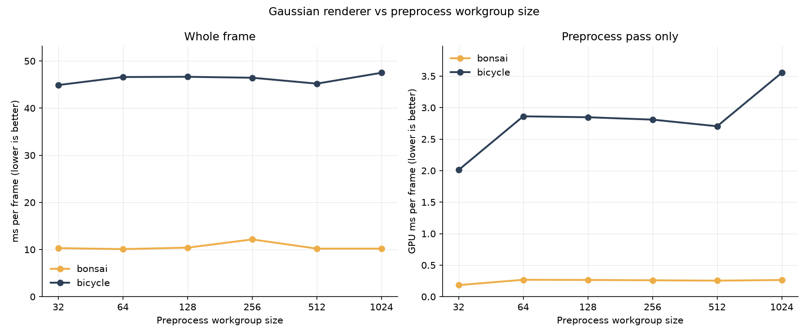
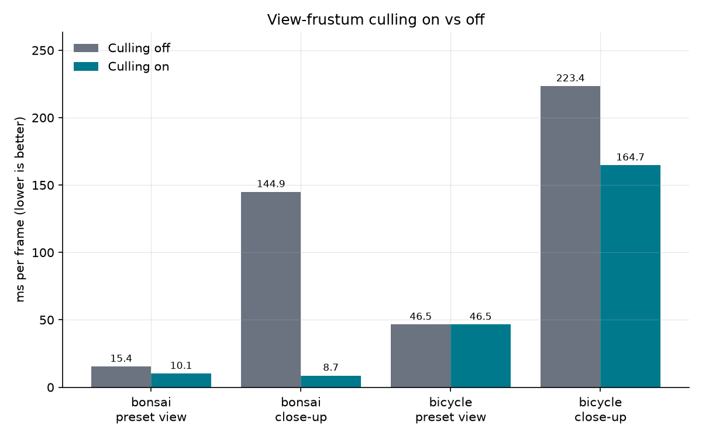
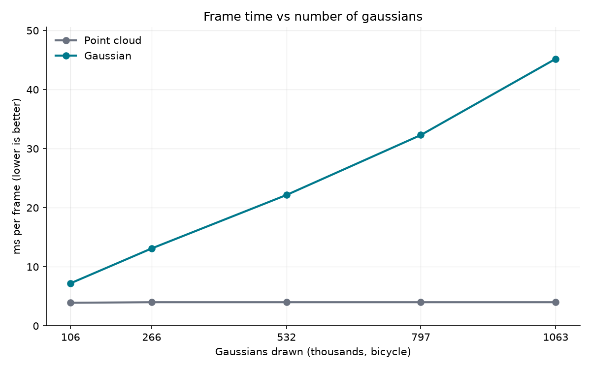
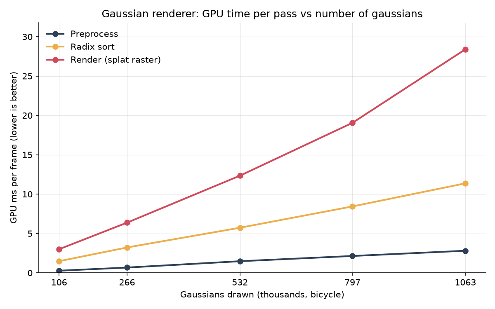

WebGPU Gaussian Splat Viewer
======================

**University of Pennsylvania, CIS 565: GPU Programming and Architecture, Project 5**

* Mark Melkumyan
  * [LinkedIn](https://www.linkedin.com/in/mark-melkumyan/), [Portfolio](https://www.marklikes.art/)
* Tested on: Google Chrome, Windows 11, i7-10750H @ 2.60GHz, 64GB RAM, GTX 1650 Ti 4096MB

### Live Demo

> Click img above to try the demo live in your browser!

## What is this?

Guassian splat render built with WebGPU and Typescript. 

- **Gaussian**:
  - *Passes:* Preprocess (compute) -> Radix sort (compute) -> Render (draw)

## Features

- Load `.ply` files to render gaussians splats.

### Screenshots

> Bonsai

> Bicycle

## Performance analysis

---
### Point cloud vs Gaussian renderer

#### Notes:

- x

---
### Workgroup size

#### Notes:

- x

---
### View-frustum culling

#### Notes:

- x

---
### Number of gaussians

### Credits

- [Vite](https://vitejs.dev/)
- [tweakpane](https://tweakpane.github.io/docs//v3/monitor-bindings/)
- [stats.js](https://github.com/mrdoob/stats.js)
- [wgpu-matrix](https://github.com/greggman/wgpu-matrix)
- Special Thanks to: Shrek Shao (Google WebGPU team) & [Differential Guassian Renderer](https://github.com/graphdeco-inria/diff-gaussian-rasterization)
